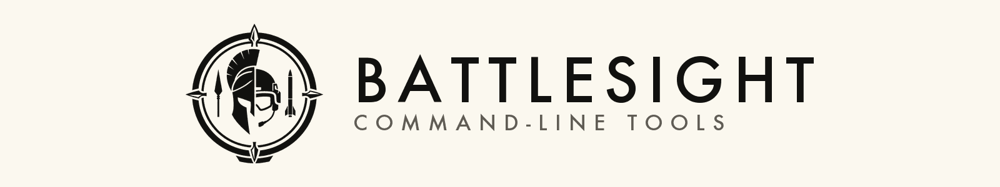

<p align="center">
  
</p>

Four Go programs build, serve, and curate the catalog. Run each from the
repository root so the default `data/` paths resolve. Every flag has a
sensible default; the tables below list the ones worth overriding.

## `battlesight` — the server

Serves the HTTP API, seeds the database on startup, and hot-reloads the
curation JSON files (`phases.json`, `wars.json`) as you edit them.

```bash
go run ./cmd/battlesight
```

| Flag | Default | Purpose |
| --- | --- | --- |
| `-port` | `8080` | Listen port. |
| `-db` | `data/battlesight.db` | SQLite database path. |
| `-seed` | `data/battles.json` | Curated battles seeded on startup. Empty to skip. |
| `-phases` | `data/phases.json` | Replay file, watched for hot-reload. Empty to skip. |
| `-wars` | `data/wars.json` | War narratives, watched for hot-reload. Empty to skip. |

Full flag reference and operational notes: [battlesight/README.md](battlesight/README.md).

## `import` — the ingest and enrichment pipeline

Pulls battles from Wikidata, enriches them from Wikipedia, backfills
gaps, validates curated files, and merges replay drafts. Pick a phase
with a flag, or run `-all` for the full sequence. `-network=false`
refuses every outbound request and serves only from the disk cache.

```bash
go run ./cmd/import -all                          # full pull and enrichment
go run ./cmd/import -validate                     # check curated JSON, no writes
go run ./cmd/import -merge-replays drafts.json    # validate and merge replay drafts
```

| Flag | Purpose |
| --- | --- |
| `-json <file>` | Import a curated battles JSON file. |
| `-wikidata` | Pull the battle catalog from Wikidata SPARQL. |
| `-wikidata-wars` | Name the war of war-less wikidata rows from Wikidata P607 or a war-class P361 target. |
| `-enrich` | Fetch Wikipedia summaries for unverified wikidata battles missing them, skipping titles that redirect to another event. |
| `-infobox` | Fill missing sides, victor, and infobox partof on unverified wikidata battles from the article infobox. |
| `-significance` | Fill thin significance on unverified wikidata battles from the article's aftermath or legacy prose. |
| `-references` | Extract citation URLs into `battle_references` for unverified wikidata battles. |
| `-coords-from-source` | Check coordinates against Wikidata P625 and the Wikipedia articles, fill 0,0 rows and move points no source backs. |
| `-geocode-missing` | Backfill coordinates from the Wikipedia coordinates API. |
| `-infobox-backfill` | Backfill coordinates and dates from infobox text. |
| `-wars` | Enrich `data/wars.json` for wars with enough battles. |
| `-merge-replays <file>` | Validate a replay-draft file and merge it into `phases.json`. |
| `-validate` | Validate curated JSON without writing. Non-zero exit on error. |
| `-all` | Run every import and enrichment step. |
| `-network` | Allow outbound HTTP. Set `-network=false` to serve only the cache. |

The `-*-dry-run` companions to the geocode and infobox flags print the
would-be summary without touching the database.

Full pipeline reference and per-source detail: [import/README.md](import/README.md).

## `fixdates` — year and era repair

One-shot pass over battles with `year = 0` but a non-empty date string.
Parses the year from the date, writes it back, and derives the era.

```bash
go run ./cmd/fixdates
```

## `quality` — completeness and mismatch reports

Opens the database read-only and never writes to it.

Without `-mismatch` it scores every battle on which fields are populated and
writes a per-era, per-region, per-war markdown report. The score measures
completeness, not factual accuracy: a true entry missing coordinates still
ranks low. Use it to direct curation, not as a measure of truth.

With `-mismatch` it prints one line per correctness class (a date the parser
cannot read, a year that disagrees with its own date or with Wikidata, a point
at 0,0 or in the ocean, a modern war outside its region, an empty or variant
war key, sides with bad names, near-duplicate rows, replay and reference keys
with no battle) with the count of rows in it. `-mismatch-ids <class>` prints
the ids in one class, one per line, for repair work. Classes that need a
column or file that is absent print `n/a` with the reason.

```bash
go run ./cmd/quality                    # writes to ~/Downloads
go run ./cmd/quality -out report.md
go run ./cmd/quality -mismatch
go run ./cmd/quality -mismatch-ids land-in-ocean
```

| Flag | Default | Purpose |
| --- | --- | --- |
| `-db` | `data/battlesight.db` | SQLite database path. |
| `-out` | `~/Downloads/battlesight-quality-<date>.md` | Report output path. |
| `-mismatch` | `false` | Print the correctness mismatch report and exit. |
| `-mismatch-ids` | | Print the row ids of one mismatch class and exit. |
| `-land` | `data/land-50m.json` | world-atlas land TopoJSON for the `land-in-ocean` class. |
| `-year-enrich` | `data/.wikicache/year-enrich` | Cache directory of the retired year-enrich pass, for `year-enrich-unreconciled`. |
| `-phases` | `data/phases.json` | Replay file checked for keys with no battle. |
| `-references` | `data/references.json` | References file checked for keys with no battle. |
